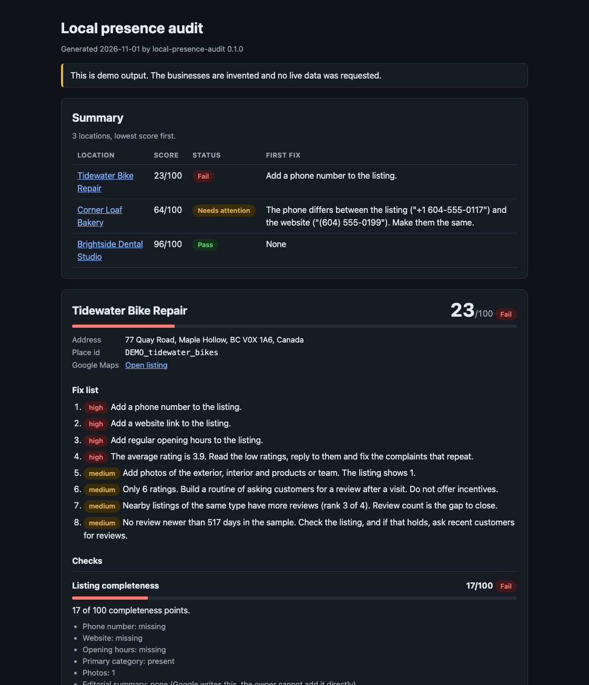

# local-presence-audit

A command-line tool that audits the public Google Maps listing of a business. It works for one location or many. It writes a JSON file, a Markdown report and a single HTML report.

This is an example tool. I wrote it to show how I approach a small data and reporting problem in TypeScript. It is not affiliated with Google. It is not a ranking tool and it does not predict search positions.



*The demo report. The businesses are invented.*

You can try it with no API key. The demo mode runs the whole pipeline on invented businesses.

## What it checks, and why

Each check is a pure function. It returns a score from 0 to 100, a status, a plain explanation and a list of fixes.

| Check | What it looks at | Why it matters |
| --- | --- | --- |
| Listing completeness | Phone, website, opening hours, primary category, photo count, editorial summary, business status | Google's own help page on local ranking says complete and accurate business information helps a profile match searches. A listing with no phone or hours also gives a customer less to act on. |
| Rating and review volume | Average rating and number of ratings | The same Google page ties review count and rating to prominence, one of its three local ranking factors. |
| Review recency | Age of the newest review in the sample the API returns | A listing whose last review is two years old can look inactive to a customer. This check is a hint, not a measurement. See Limits. |
| Hours sanity | Days with no hours, openings under one hour, openings over 18 hours, missing closing times, the 24 hour pattern | Wrong hours send people to a closed door. Most of these come from typing errors. |
| Website consistency | Fetches the website on the listing, reads schema.org `LocalBusiness` JSON-LD, compares name, address and phone with the listing | If the site and the listing disagree, a customer does not know which one to trust. The comparison normalises formatting first, so "St." and "Street" or "+1 604..." and "(604)..." are not reported as differences. |
| Competitor comparison | The nearest listings with the same primary type within a radius, ranked on rating and review count | A 4.3 rating means different things on a street where everyone has 4.8 and one where everyone has 3.9. |

The Google page I refer to is "Tips to improve your local ranking on Google" in the Business Profile Help. It names relevance, distance and prominence as the factors. It does not publish weights, and neither do I.

## Run the demo

You need Node 20 or newer.

```sh
npm install
npm run demo
```

This writes `reports/demo-report.json`, `reports/demo-report.md` and `reports/demo-report.html`. Open the HTML file in a browser.

The demo makes no network requests. A stand-in for `fetch` answers from the files in `fixtures/`. The responses have the same shape as the real API, and the stand-in honours the field mask the way the API does. The real client and the real checks run on top of it. The demo uses a fixed date (2026-11-01) so the output is the same on every run.

A committed copy of the demo output is in [`examples/`](examples/). The businesses, addresses and phone numbers in it are invented.

## Run it with your own key

You need a Google Maps Platform API key with "Places API (New)" enabled. Billing must be active on the Google Cloud project.

```sh
cp .env.example .env      # then put your key in .env
```

One location by place id:

```sh
npm run audit -- --place-id ChIJj61dQgK6j4AR4GeTYWZsKWw
```

One location by name and city:

```sh
npm run audit -- --query "Business name, City"
```

Many locations from a CSV file:

```sh
npm run audit -- --input locations.csv
```

The CSV needs a header row. The columns are `label`, `place_id`, `query`, `name` and `city`, in any order. Each row needs a `place_id`, or a `query`, or a `name` (with `city` if you have it). See [`fixtures/locations.csv`](fixtures/locations.csv) for an example.

Options:

| Option | Default | Meaning |
| --- | --- | --- |
| `--out <dir>` | `reports` | Output directory |
| `--basename <name>` | `report` | Output file name without extension |
| `--radius <meters>` | `2000` | Competitor search radius, 1 to 50000 |
| `--competitors <n>` | `10` | How many of the nearest competitors to compare, 1 to 19 |
| `--skip <list>` | none | Comma separated: `reviews`, `website`, `competitors` |
| `--language <code>` | API default | `languageCode` for the Places API |
| `--region <code>` | none | `regionCode` for the Places API |

You can also build it and run the compiled file:

```sh
npm run build
node dist/cli.js audit --demo
```

## Output

- `report.json`: everything the reports are built from.
- `report.md`: a Markdown report.
- `report.html`: one self-contained page. It has inline CSS, no scripts and no external requests. It follows the light or dark setting of the browser.

Each location gets an overall score, the result of every check and a fix list ordered by priority. When there is more than one location, the report starts with a summary table. The table is sorted by score, lowest first, so the location that needs the most work is at the top.

A location that cannot be found or fetched is listed with the error. It does not stop the run.

## Scoring

Every check scores 0 to 100. The status is `pass` at 80 or more, `warn` at 50 or more and `fail` below that. A check that could not run is `skipped`.

The overall score is a weighted mean of the checks that ran:

| Check | Weight |
| --- | --- |
| Listing completeness | 25 |
| Rating and review volume | 20 |
| Hours sanity | 15 |
| Website consistency | 15 |
| Competitor comparison | 15 |
| Review recency | 10 |

Skipped checks are left out and the other weights are scaled up. A listing with no website is not scored on website consistency. It loses the points in completeness instead.

How each check gets its number:

- **Completeness.** Phone 20, website 20, hours 20, primary category 15, photos up to 20 (2 per photo, and the API returns at most 10), editorial summary 5. Google writes the editorial summary, not the owner, so it has a small weight and no fix. A permanently closed listing scores 0. A temporarily closed one is capped at 50.
- **Rating and volume.** 60% rating, 40% volume. Rating is linear from 3.0 stars (0 points) to 4.7 stars (100). Volume is on a log scale and reaches 100 at 200 ratings.
- **Recency.** Newest review in the sample: 30 days or less is 100, 90 days is 80, 180 days is 55, 365 days is 30, older is 10.
- **Hours.** Starts at 100. No hours at all is 0. Minus 20 for an opening with no closing time, 15 for an opening under an hour, 10 for an opening over 18 hours, and 10 for each closed day beyond two.
- **Website.** Name, address and phone each count for a third. A match is full credit, a field missing from the structured data is half, a mismatch is none. A page with no `LocalBusiness` data scores 50. A site that does not load scores 20. Any mismatch stops the check from showing as a pass.
- **Competitors.** First place among the compared listings is 100, last place is 0. The score is the mean of the rating rank and the review count rank.

These numbers are my rules of thumb. They are in [`src/score.ts`](src/score.ts) and the files in [`src/checks/`](src/checks/), and they are easy to change.

## API use, cost and terms

The tool calls three methods of the Places API (New):

| Method | Used for | Fields requested |
| --- | --- | --- |
| Text Search, `POST /v1/places:searchText` | Turning a name and city into a place id. Not called when you give a place id. | `places.id` |
| Place Details, `GET /v1/places/{id}` | The listing itself | `id`, `displayName`, `formattedAddress`, `location`, `googleMapsUri`, `businessStatus`, `primaryType`, `primaryTypeDisplayName`, `types`, `photos`, `nationalPhoneNumber`, `internationalPhoneNumber`, `websiteUri`, `regularOpeningHours`, `rating`, `userRatingCount`, `reviews`, `editorialSummary` |
| Nearby Search, `POST /v1/places:searchNearby` | Competitors | `places.id`, `places.displayName`, `places.location`, `places.businessStatus`, `places.rating`, `places.userRatingCount` |

Every request sends the `X-Goog-FieldMask` header, which the API requires. The key goes in the `X-Goog-Api-Key` header, never in the URL.

Google bills by field tier. The most expensive field in the mask decides the SKU for the whole request. When I checked the documentation in November 2026:

- `places.id` alone keeps Text Search in its cheapest tier, Essentials (IDs Only).
- `reviews` and `editorialSummary` put Place Details in the top tier, Enterprise + Atmosphere. `--skip reviews` drops both fields, which leaves the request in the Enterprise tier. The recency check is then skipped.
- `rating` and `userRatingCount` put Nearby Search in the Enterprise tier. `--skip competitors` avoids that request.

A full audit of one location is two or three billable requests. Check the current price list before you run a large CSV. Prices and tiers change.

You must follow the Google Maps Platform terms and the Places API policies. Two points matter for a tool like this:

- **Caching.** The policies limit how long you may store Places content. Place ids are the exception and can be stored. The reports this tool writes contain listing content such as names, addresses and ratings. Treat them as working documents. Read the policies before you archive them or pass them on.
- **Attribution.** Places content must be attributed to Google Maps when it is shown. The reports carry a "Listing data: Google Maps" line. The tool never stores review text or reviewer names. It only reads review dates.

The website check sends one GET request to the URL on the listing, with a `local-presence-audit` user agent. Use `--skip website` if you do not want that.

## Limits

- **Public data only.** The tool sees what the Places API returns. It does not see the owner side of a Business Profile. There are no insights, no posts, no Q&A, no owner replies to reviews, no service lists and no attributes management.
- **No owner description.** The description an owner writes in the Business Profile is not in the API. The `editorialSummary` field is a different text that Google writes, and many places do not have one.
- **Review recency is a small sample.** The API returns at most five reviews, chosen by relevance, not by date. A newer review may exist. A good recency result is reliable. A poor one means "check the listing".
- **Photo count stops at 10.** The API returns at most ten photos, so the tool cannot tell 10 from 500.
- **Scores are rules of thumb.** They are not Google's ranking. A high score does not mean a listing ranks well.
- **Competitors are a rough set.** They are the nearest listings that share the primary type. Nearby Search only accepts some types as a filter. If the type is not accepted, the check is skipped and the report says why. The comparison uses rating and review count only.
- **Website check is narrow.** It reads the one URL on the listing and only JSON-LD. It does not run JavaScript, follow links to a contact page or read microdata. A site that adds structured data in the browser will look like it has none. Subtypes of `LocalBusiness` are recognised from a list of common ones.
- **Address matching is approximate.** It compares tokens after normalising common English street words. It has not been tuned for other languages or address formats.
- **Regular hours only.** Holiday and special hours are not checked.

## What I verified and what I did not

- The tests pass. They use a mocked `fetch` and cover field mask building, every check with edge cases, phone, name and address normalisation, JSON-LD parsing, CSV input, scoring and report rendering. The rendered demo reports are compared with the committed files in `examples/`.
- The demo runs end to end, from source and from the compiled build. I opened the HTML report in a browser at desktop and phone width in light mode. I did not view it in dark mode. The dark colours are in the CSS and I checked their contrast by calculation only.
- I checked endpoints, headers and field names against the official Places API (New) documentation in November 2026.
- **I have not run it against the live API with a valid key.** I made one request to Place Details with an invalid key. It reached the API and the error was reported correctly. That is all the live testing there is. The fixtures follow the documented response shapes, but real responses may differ in ways I have not seen. Expect to find rough edges on the first live run.
- I have not tested it on Windows.

## Development

```sh
npm run typecheck
npm test
npm run build
npm run demo -- --out examples   # refresh the committed example after a change
```

There are no runtime dependencies. TypeScript and tsx are the only dev dependencies. Tests use the Node test runner.

```
src/
  cli.ts            command line
  audit.ts          pipeline for one location and for a run
  places.ts         Places API (New) client and field masks
  checks/           one file per check
  normalize.ts      phone, name and address comparison
  jsonld.ts         schema.org JSON-LD reader
  score.ts          weights, statuses, fix ordering
  input.ts          CSV input
  report/           Markdown and HTML renderers
  demo.ts           fixture-backed stand-in for fetch
fixtures/           invented places, sites and a sample CSV
examples/           committed demo output
test/
```

## License

MIT. Copyright (c) 2026 Mert Atalay.
